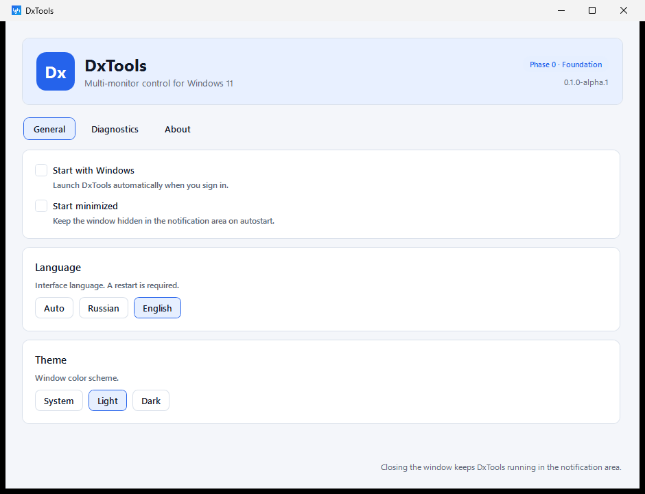
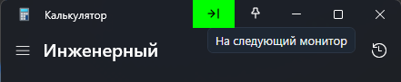
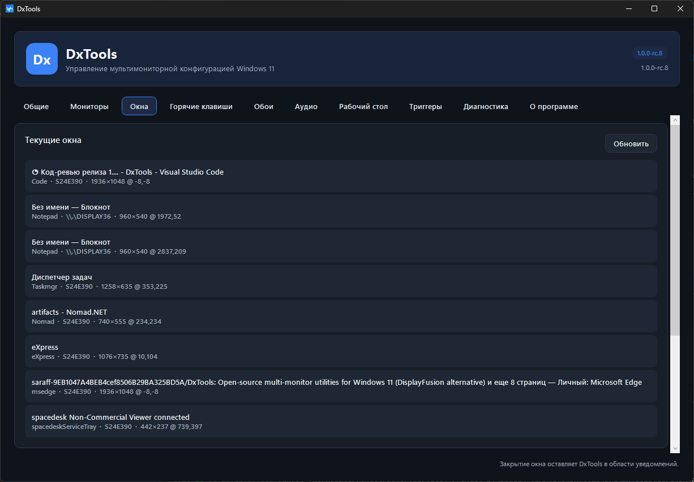
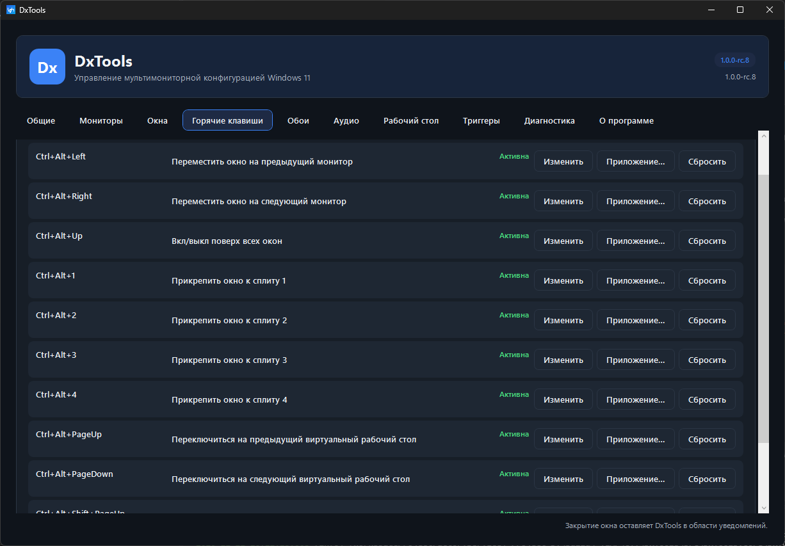
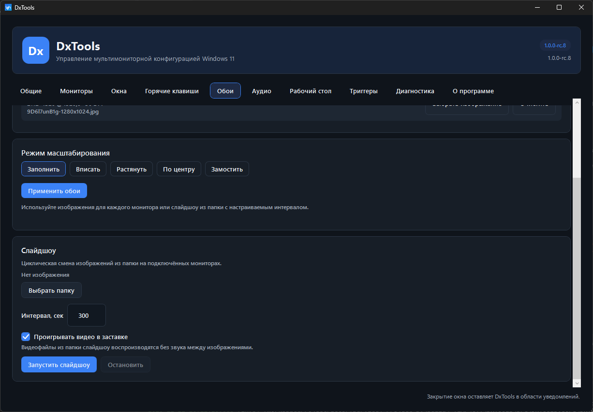
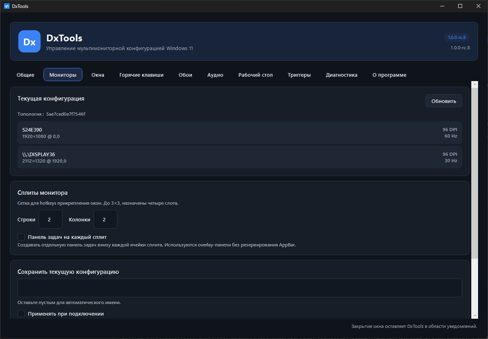

[Русский](README.md) | **English**

# DxTools

[](https://github.com/saraff-9EB1047A4BEB4cef8506B29BA325BD5A/DxTools/releases/download/v1.0.0/DxTools-1.0.0-x64.msi)

DxTools is an open-source Windows 11 utility that reproduces the key features
of DisplayFusion: monitor profiles, multi-monitor taskbars, window management,
wallpapers, hotkeys, triggers and scripts.

- License: GNU GPL v2 (`GPL-2.0-only`)
- Platform: Windows 11 22H2+ (x64; ARM64 — cross-build), .NET 10
- Status: 1.0.0 — GitHub Release published













## Features in the current version (1.0.0)

- MSI installer (per-machine, x64 and ARM64) with a GPLv2 license dialog;
- system tray application and settings window;
- monitor profiles: save the current configuration, apply,
  confirmation with automatic rollback, auto-apply by monitor set;
- taskbars on secondary monitors: AppBar, window grouping by application,
  icon buttons, activate/minimize, clock, replacement of the Windows taskbar,
  hiding in fullscreen, pinned applications, DWM live preview on hover,
  auto-hide;
- window position profiles: save, apply and delete;
- moving the active window between monitors with DPI and always-on-top
  awareness;
- UIAccess helper for moving, pinning and activating elevated windows
  (enabled only with a signed `DxTools.Helper.exe`);
- configurable hotkeys via a low-level keyboard hook, including Win
  combinations, chains of up to four steps and per-application binding, with a
  capture dialog;
- CLI application of display/window profiles and wallpapers;
- triggers: startup, display change, window/process creation → profile,
  wallpaper, program or C# script;
- caption-style buttons in the active window title bar: move to the next
  monitor and always-on-top, lime hover;
- monitor splits: grid up to 3×3 and `Ctrl+Alt+1..4` snap hotkeys;
- system tray mirror in a taskbar popup with live updates and icon context
  menus on right-click;
- separate overlay taskbars for each split cell;
- taskbar button context menus: move a window to any monitor (DxTools taskbars
  and Ctrl+RMB on the Windows primary taskbar);
- desktop icon profiles (save/apply/delete);
- default audio device switching;
- multi-monitor screensaver `DxTools.scr` with images and video from the
  slideshow folder, including preview in the lock screen settings;
- hotkeys for navigating virtual desktops and moving windows between them;
- Explorer context menu: settings, apply wallpaper and set the selected image
  as the wallpaper of the monitor under the cursor;
- ARM64 cross-build, `DxTools-1.0.0-arm64.msi` and verification via
  administrative install;
- SECURITY.md, `docs/signing.md` and the signing script `build/sign.ps1`;
- per-monitor wallpapers: composite canvas, Fill/Fit/Stretch/Center/Tile
  modes;
- wallpaper slideshow from a folder with a configurable interval;
- `--exit` to shut down a running instance gracefully;
- export and import of a settings and profiles backup;
- JSON settings with atomic writes and recovery from corruption;
- autostart at sign-in;
- Russian and English UI (language switch after restart);
- light/dark/system theme;
- single application instance, a command to open settings from a second copy;
- file logs and a crash handler;
- safe mode (`--safe-mode`);
- native `DxTools.Native.dll` library with C ABI v6, DisplayConfig, LL hook and
  handshake.

UIAccess requires a certificate-signed `DxTools.Helper.exe` installed in
Program Files and user consent on first launch. Without a signature the app
runs in normal mode. Signing is paused as of 2026-11-23: the SignPath
Foundation application was reviewed on 2026-11-23 and deferred because the
project does not yet have enough public visibility; commercial OV
certificates are not available to applicants in Belarus. No application is
active and no certificate is being purchased. Until then, builds are published
unsigned; see
[CODE_SIGNING.md](CODE_SIGNING.md). The ARM64 runtime test is deferred for
budget reasons; the security review, soak test and UAC checks are
considered accepted. Full plan:
[spec.md](spec.md), security policy: [SECURITY.md](SECURITY.md),
security review: [docs/security-review.md](docs/security-review.md),
release checklist: [docs/release-checklist.md](docs/release-checklist.md).

## Editions and support

- **Community** — free build under GNU GPL v2. The license permits use for any
  purpose, including commercial; support is provided through GitHub Issues and
  Discussions with no guaranteed response time.
- **Pro Support** — annual support subscription for organizations: SLA,
  prioritized fixes, security fixes, deployment artifacts and procurement
  documents. This is a services agreement; the software remains under GPLv2 and
  fixes go into public releases.

Terms, SLA and pricing: [docs/commercial.en.md](docs/commercial.en.md)
(RU: [docs/commercial.md](docs/commercial.md)).
How to get help: [SUPPORT.md](SUPPORT.md). Donations are welcome.

## Code signing policy

Code signing is paused as of 2026-11-23.
[CODE_SIGNING.md](CODE_SIGNING.md) describes the requirements for future
signing: builds only from GitHub Actions, manual approval, MSI deep signing and
`signtool` verification. If the project revisits it, the main path is a new
SignPath Foundation application after broader public adoption; commercial CAs
are not available in the region. The section will be updated once signing is
enabled. Technical details: [docs/signing.md](docs/signing.md).

## Build requirements

- Windows 11 x64;
- .NET SDK 10.0.400+;
- Visual Studio 2022/2026 with the "Desktop development with C++" workload and
  Windows 11 SDK 10.0.26100;
- CMake 3.28+ (for the native library);
- WiX Toolset 6 is restored as a NuGet package.

## Build

```powershell
dotnet build DxTools.sln -c Release
dotnet test DxTools.sln -c Release
powershell -ExecutionPolicy Bypass -File build/build.ps1 -Configuration Release
```

Result: `artifacts/publish/` (self-contained application) and
`artifacts/DxTools-1.0.0-x64.msi`.

Local native builds without MSVC are possible via portable Zig (see
`build/build.ps1`), but the MSVC build in CI is the reference.

## Structure

```
src/DxTools.App        WPF UI, tray, settings
src/DxTools.Core       domain, settings, utilities
src/DxTools.Engine     background services
src/DxTools.Interop    P/Invoke and native DLL loading
native/                C++ library
tests/                 unit tests
installer/             WiX 6 MSI
build/                 build scripts
```

## Documentation

- [spec.md](spec.md) — specification and plan;
- [docs/reports/phase-0.md](docs/reports/phase-0.md) — Phase 0 report;
- [docs/reports/phase-1.md](docs/reports/phase-1.md) — Phase 1 report;
- [docs/reports/phase-2.md](docs/reports/phase-2.md) — Phase 2 report;
- [docs/reports/phase-2b.md](docs/reports/phase-2b.md) — Phase 2B report;
- [docs/reports/phase-2c.md](docs/reports/phase-2c.md) — Phase 2C report;
- [docs/reports/phase-2d.md](docs/reports/phase-2d.md) — Phase 2D report;
- [docs/reports/phase-2e.md](docs/reports/phase-2e.md) — Phase 2E report;
- [docs/reports/phase-2f.md](docs/reports/phase-2f.md) — Phase 2F report;
- [docs/reports/phase-2g.md](docs/reports/phase-2g.md) — Phase 2G report;
- [docs/reports/phase-2h.md](docs/reports/phase-2h.md) — Phase 2H report;
- [docs/reports/phase-2i.md](docs/reports/phase-2i.md) — Phase 2I report;
- [docs/reports/phase-2j.md](docs/reports/phase-2j.md) — Phase 2J report;
- [docs/reports/phase-2k.md](docs/reports/phase-2k.md) — Phase 2K report;
- [docs/reports/phase-3a.md](docs/reports/phase-3a.md) — Phase 3A report;
- [docs/reports/phase-3b.md](docs/reports/phase-3b.md) — Phase 3B report;
- [docs/reports/phase-3c.md](docs/reports/phase-3c.md) — Phase 3C report;
- [docs/reports/phase-3d.md](docs/reports/phase-3d.md) — Phase 3D report;
- [docs/reports/rc-1.0.0-rc.8.md](docs/reports/rc-1.0.0-rc.8.md) — RC 1.0.0-rc.8 report;
- [docs/reports/rc-1.0.0-rc.7.md](docs/reports/rc-1.0.0-rc.7.md) — RC 1.0.0-rc.7 report;
- [docs/reports/rc-1.0.0-rc.6.md](docs/reports/rc-1.0.0-rc.6.md) — RC 1.0.0-rc.6 report;
- [docs/reports/rc-1.0.0-rc.5.md](docs/reports/rc-1.0.0-rc.5.md) — RC 1.0.0-rc.5 report;
- [docs/reports/rc-1.0.0-rc.4.md](docs/reports/rc-1.0.0-rc.4.md) — RC 1.0.0-rc.4 report;
- [docs/reports/rc-1.0.0-rc.3.md](docs/reports/rc-1.0.0-rc.3.md) — RC 1.0.0-rc.3 report;
- [docs/reports/rc-1.0.0-rc.2.md](docs/reports/rc-1.0.0-rc.2.md) — RC 1.0.0-rc.2 report;
- [docs/reports/rc-1.0.0.md](docs/reports/rc-1.0.0.md) — RC 1.0.0-rc.1 report;
- [USER_MANUAL.md](USER_MANUAL.md) — user manual;
- [SECURITY.md](SECURITY.md) — security policy;
- [SUPPORT.md](SUPPORT.md) — how to get support;
- [CONTRIBUTING.md](CONTRIBUTING.md) — contribution guidelines;
- [CODE_SIGNING.md](CODE_SIGNING.md) — code signing policy;
- [TRADEMARK.md](TRADEMARK.md) — brand usage policy;
- [docs/security-review.md](docs/security-review.md) — security review;
- [docs/release-checklist.md](docs/release-checklist.md) — release checklist;
- [docs/commercial.md](docs/commercial.md) — editions and commercial support (RU);
- [docs/commercial.en.md](docs/commercial.en.md) — editions and commercial support;
- [docs/arm64.md](docs/arm64.md) — ARM64 build;
- [docs/signing.md](docs/signing.md) — signing and UIAccess;
- [CHANGELOG.md](CHANGELOG.md) — changelog;
- [THIRD-PARTY-NOTICES.md](THIRD-PARTY-NOTICES.md) — third-party components.

## Contributing

The project is distributed under GPLv2. By submitting changes you agree to
license them under the same terms. Do not add code or assets incompatible with
GPLv2, and do not add license checks or DRM to the code: the commercial model
is based on support, not restrictions. See [CONTRIBUTING.md](CONTRIBUTING.md)
for details.

## License

Copyright (C) 2026 DxTools contributors.

The code is distributed under GNU GPL v2 (`GPL-2.0-only`): the program may be
used, modified and redistributed for any purpose, including commercial.
Commercial support (Pro Support) is a separate services agreement and does not
limit the rights granted by the GPL.

The program is distributed in the hope that it will be useful, but WITHOUT ANY
WARRANTY. See [LICENSE](LICENSE) for the full text.
