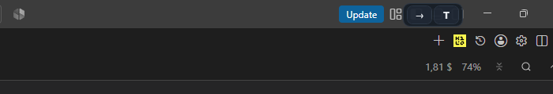
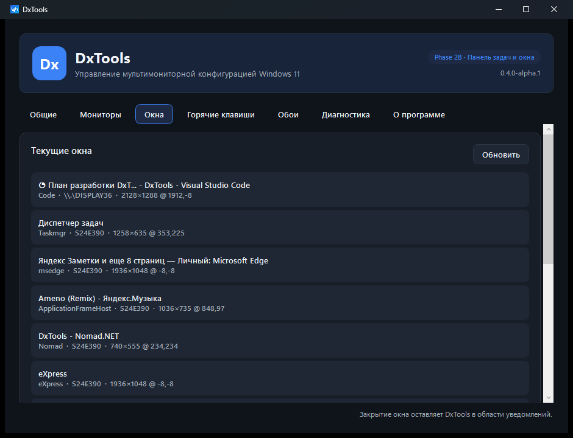

# DxTools

DxTools — открытая утилита для Windows 11, повторяющая ключевые возможности
DisplayFusion: профили мониторов, мультимониторные панели задач, управление
окнами, обои, горячие клавиши, триггеры и скрипты.

- Лицензия: GNU GPL v2 (`GPL-2.0-only`)
- Платформа: Windows 11 22H2+ (x64), .NET 10
- Статус: Phase 2K (ядро) завершён, ожидает подтверждения






## Возможности текущей версии (0.13.0-alpha)

- установщик MSI (per-machine, x64) с лицензионным диалогом GPLv2;
- приложение в системном трее, окно настроек;
- профили мониторов: сохранение текущей конфигурации, применение,
  подтверждение с автоматическим откатом, авто-применение по набору мониторов;
- панель задач на дополнительных мониторах: AppBar, группировка окон по
  приложению, кнопки с иконками, активация/сворачивание, часы, замена панели
  задач Windows, скрытие для fullscreen, закреплённые приложения,
  DWM live-превью при наведении, автоскрытие;
- профили позиций окон: сохранение, применение и удаление;
- перенос активного окна между мониторами с учётом DPI и always-on-top;
- настраиваемые горячие клавиши через низкоуровневый keyboard hook,
  включая сочетания с Win и двухшаговые цепочки, с диалогом захвата;
- CLI-применение профилей дисплеев/окон и обоев;
- триггеры: запуск, смена дисплея, создание окна/процесса → профиль,
  обои, программа или C#-скрипт;
- кнопки в заголовке активного окна: перенос на следующий монитор и
  always-on-top;
- сплиты монитора: сетка до 3×3 и snap hotkeys `Ctrl+Alt+1..4`;
- зеркало системного трея в popup на панели задач с live-обновлением;
- отдельные overlay-панели задач для каждой ячейки сплита;
- обои на каждый монитор: композитное полотно, режимы Fill/Fit/Stretch/
  Center/Tile;
- слайдшоу обоев из папки с настраиваемым интервалом;
- `--exit` для корректного завершения работающего экземпляра;
- экспорт и импорт резервной копии настроек и профилей;
- JSON-настройки с атомарной записью и восстановлением после повреждения;
- автозапуск при входе в систему;
- русский и английский интерфейс (переключение языка — после перезапуска);
- светлая/тёмная/системная тема;
- единственный экземпляр приложения, команда открытия настроек из второй копии;
- файловые логи и crash handler;
- безопасный режим (`--safe-mode`);
- нативная библиотека `DxTools.Native.dll` с C ABI v2, DisplayConfig и handshake.

Следующий этап — Phase 3: виртуальные десктопы, screensaver, иконки,
аудио, UIAccess, ARM64 и подпись.
Подробный план: [spec.md](spec.md).

## Требования для сборки

- Windows 11 x64;
- .NET SDK 10.0.400+;
- Visual Studio 2022/2026 с workload «Desktop development with C++» и
  Windows 11 SDK 10.0.26100;
- CMake 3.28+ (для нативной библиотеки);
- WiX Toolset 6 восстанавливается как NuGet-пакет.

## Сборка

```powershell
dotnet build DxTools.sln -c Release
dotnet test DxTools.sln -c Release
powershell -ExecutionPolicy Bypass -File build/build.ps1 -Configuration Release
```

Результат: `artifacts/publish/` (self-contained приложение) и
`artifacts/DxTools-0.13.0-x64.msi`.

Локальная сборка нативной библиотеки без MSVC возможна через portable Zig
(см. `build/build.ps1`), но эталонной считается сборка MSVC в CI.

## Структура

```
src/DxTools.App        WPF UI, трей, настройки
src/DxTools.Core       домен, настройки, утилиты
src/DxTools.Engine     фоновые сервисы
src/DxTools.Interop    P/Invoke и загрузка native DLL
native/                C++ библиотека
tests/                 unit-тесты
installer/             WiX 6 MSI
build/                 сборочные скрипты
```

## Документация

- [spec.md](spec.md) — спецификация и план;
- [docs/reports/phase-0.md](docs/reports/phase-0.md) — отчёт Phase 0;
- [docs/reports/phase-1.md](docs/reports/phase-1.md) — отчёт Phase 1;
- [docs/reports/phase-2.md](docs/reports/phase-2.md) — отчёт Phase 2;
- [docs/reports/phase-2b.md](docs/reports/phase-2b.md) — отчёт Phase 2B;
- [docs/reports/phase-2c.md](docs/reports/phase-2c.md) — отчёт Phase 2C;
- [docs/reports/phase-2d.md](docs/reports/phase-2d.md) — отчёт Phase 2D;
- [docs/reports/phase-2e.md](docs/reports/phase-2e.md) — отчёт Phase 2E;
- [docs/reports/phase-2f.md](docs/reports/phase-2f.md) — отчёт Phase 2F;
- [docs/reports/phase-2g.md](docs/reports/phase-2g.md) — отчёт Phase 2G;
- [docs/reports/phase-2h.md](docs/reports/phase-2h.md) — отчёт Phase 2H;
- [docs/reports/phase-2i.md](docs/reports/phase-2i.md) — отчёт Phase 2I;
- [docs/reports/phase-2j.md](docs/reports/phase-2j.md) — отчёт Phase 2J;
- [docs/reports/phase-2k.md](docs/reports/phase-2k.md) — отчёт Phase 2K;
- [USER_MANUAL.md](USER_MANUAL.md) — руководство пользователя;
- [CHANGELOG.md](CHANGELOG.md) — история версий;
- [THIRD-PARTY-NOTICES.md](THIRD-PARTY-NOTICES.md) — сторонние компоненты.

## Участие

Проект распространяется по GPLv2. Отправляя изменения, вы соглашаетесь
лицензировать их на тех же условиях. Не добавляйте код и ресурсы,
несовместимые с GPLv2.

## Лицензия

Copyright (C) 2026 DxTools contributors.

Программа распространяется в надежде, что она будет полезной, но БЕЗ
КАКИХ-ЛИБО ГАРАНТИЙ. Полный текст — в [LICENSE](LICENSE).
